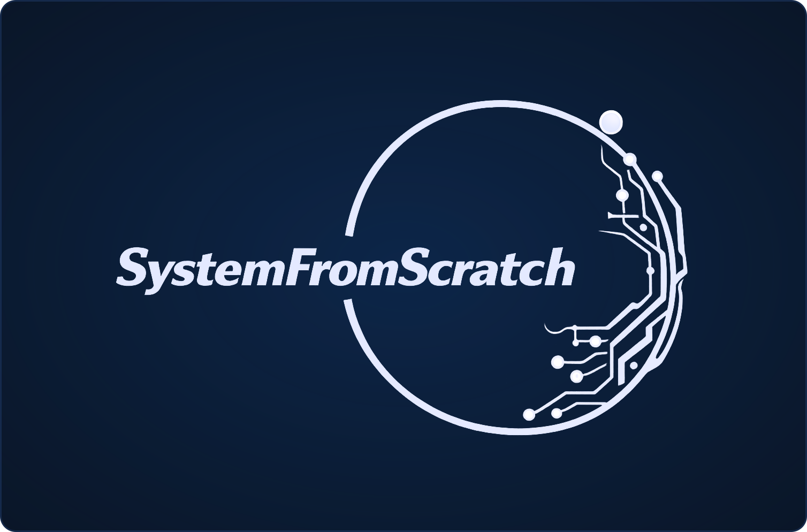

  

<h1 align="center">Embedded systems built from scratch</h1>

  We develop reliable, secure, high-performance embedded software for connected products: 
  from bare metal to Linux, MISRA-compliant and ready for the EU Cyber Resilience Act.

  
  
  
  

---

## What we do

From the first board on the bench to a secure, maintainable product in the field: one partner for firmware, platform software and compliance, with specialist engineers joining when your project needs them.

| Service | What you get |
| --- | --- |
| **Embedded Software Development** | Bare-metal, RTOS and Linux application firmware in C/C++, including OTA. |
| **BSP & Device Drivers** | Board support packages, bootloaders and low-level drivers for MCUs, SoCs, FPGAs and custom hardware. |
| **RTOS & Embedded Linux** | Zephyr, FreeRTOS and Embedded Linux (Yocto, Buildroot): porting, integration and reproducible builds. |
| **Hardware Bring-up & Integration** | Firmware side of first boot, validation and production support. Hardware design through our partner engineers. |
| **Cybersecurity & CRA Readiness** | Secure boot, firmware integrity, threat modelling and a secure development lifecycle for the EU Cyber Resilience Act. |
| **Compliance & Consulting** | MISRA C/C++, static analysis, code and architecture reviews and long-term technical advisory. |

## Is your firmware ready for the CRA?

The CRA's vulnerability reporting obligations have applied since **11 September 2026**, and the full requirements apply from **11 December 2027**. We review your current firmware, show you where the gaps are and help you close them.
👉 [Ask for a CRA gap review](mailto:avynohradov@systemfromscratch.com?subject=CRA%20gap%20review)

## Open-source libraries you can audit line by line

The same engineering standard we bring to client firmware, published in the open:
**MISRA C:2012, 0 violations** · **100 % line and branch coverage** · **cross-checked against an independent Python twin** · **C11, no heap, no RTOS, measured stack**.

| Library | What it does |
| --- | --- |
| [**Baton-C**](https://antonvynohradov.github.io/Baton-C/) | Deterministic master/slave bus over a single-wire UART or RS-485 |
| [**ISOTP-C**](https://antonvynohradov.github.io/isotp-c/) | ISO-TP (ISO 15765-2) transport over CAN |
| [**DXL2-C**](https://antonvynohradov.github.io/DXL2-C/) | ROBOTIS DYNAMIXEL Protocol 2.0 |
| [**Stepper-C**](https://antonvynohradov.github.io/Stepper-C/) | Stepper motor control with sensorless stall detection |

Each release ships with a static library, a MISRA report and a printable PDF user manual. See all [projects](https://systemfromscratch.github.io/projects.html) and [articles](https://systemfromscratch.github.io/articles.html).

## Have a project in mind?

Tell us about your product, timeline and constraints. We can start with a short call or a fixed-scope code, MISRA or CRA review of your existing firmware.

📩 **[avynohradov@systemfromscratch.com](mailto:avynohradov@systemfromscratch.com?subject=Project%20inquiry)** · 🌐 **[systemfromscratch.github.io](https://systemfromscratch.github.io/)** · 📍 Poland, remote worldwide

Founded by <a href="https://github.com/AntonVynohradov">Anton Vynohradov</a>. SystemFromScratch® is a registered trademark.
